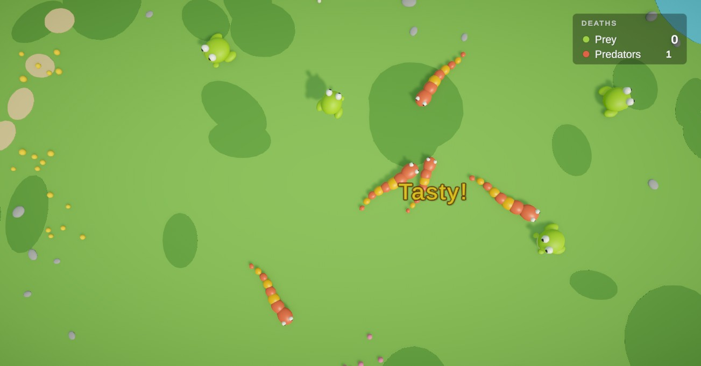
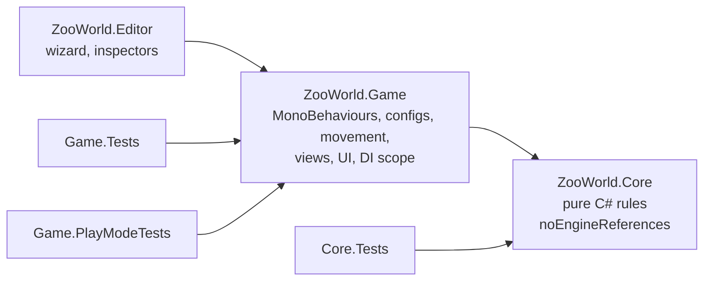
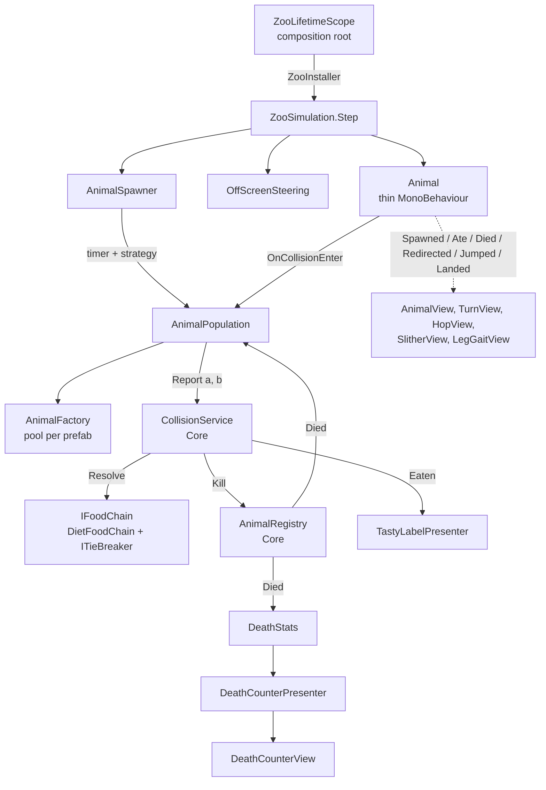

# Zoo World

A small top-down 3D zoo: frogs hop, snakes slither, predators eat, and a counter keeps score. The point of the project is the **animal architecture**: adding the next thousand animals should mostly be content work, not code.



- **Unity 6.3 LTS (6000.3.27f1)**, URP, built-in physics (Rigidbody + colliders), no ECS
- **VContainer** for DI, **uGUI + TextMeshPro** for UI, **PrimeTween** for view animations only
- Unity Test Framework: **102 tests** (EditMode + PlayMode), including a headless simulation

## Open and run

1. Clone and open the folder with Unity **6000.3.27f1**. On the first open, packages resolve from the Unity registry, OpenUPM (VContainer) and npmjs (PrimeTween), so it needs internet once.
2. Open `Assets/ZooWorld/Scenes/Zoo.unity` and press **Play**.

To try the extended zoo (adds a turtle and a spider), select the `Zoo` object in the scene and swap **World Settings** from `DefaultWorld` to `ExtendedWorld`.

## The spec, point by point

| Spec | Where |
|---|---|
| Top-down camera | `Zoo` scene: perspective camera looking straight down |
| An animal appears every 1–2 s and moves randomly | `SpawnTimer` (interval drawn from [min, max]) + `WeightedRandomSpawnStrategy`; random headings and turns in the movements |
| Animals collide by physics | Non-kinematic Rigidbodies with a bouncy, frictionless physic material |
| Off screen → turn back | `CameraPlayArea` (viewport projected on the ground) + `OffScreenSteering` |
| Prey vs prey: fly apart by physics | `DietFoodChain` returns `Bounce`; physics separates them, movements follow the bounce |
| Predator vs prey: prey dies and disappears | `CollisionService` kills the prey at once; the view plays a short poof, then the object returns to the pool |
| Predator vs predator: one survives | Both can eat each other → `ITieBreaker` (seeded coin flip) picks the survivor |
| "Tasty!" under a predator that eats | `TastyLabelPresenter` + pooled `TastyLabel` |
| Frog: prey, jumps a fixed distance every X s | `Frog` config + `JumpMovementSettings` (interval, distance, duration) |
| Snake: predator, linear movement | `Snake` config (diet `[Animal]`) + `LinearMovementSettings` (speed) |
| Dead prey / predator counter, top right, uGUI | `DeathStats` → `DeathCounterPresenter` → `DeathCounterView` (uGUI Canvas + TMP) |
| DI / frameworks / patterns | VContainer composition root, MVP, strategy, factory + object pool, adapters. See [Docs/Patterns.md](Docs/Patterns.md) |

## Architecture

### Assemblies

The compiler enforces the dependency direction: **Game → Core**, never the other way.



**`ZooWorld.Core` has no engine references** (`"noEngineReferences": true`). It holds the rules: tags and diets, food chain resolution, the predator tie-break, "each pair is processed once", spawn timing and strategy, stats, and the `IRandom` / `ITimeProvider` abstractions. Since it can't touch `UnityEngine`, the rules are fast to test, can't depend on scene state by accident, and could run on a plain .NET server.

`ZooWorld.Game` is the Unity side: thin MonoBehaviours, ScriptableObject configs, movement (Unity vectors), views, UI and the VContainer scope, plus adapters that map config assets to Core data (`AnimalProfileMapper` turns `AnimalTag` assets into plain `TagId`s).

### How the pieces talk



- **Content is authored in the Editor, systems are wired in code.** The scene holds the camera, light, HUD canvas, an `Arena` prefab instance and one `ZooLifetimeScope` with references to configs. Services, the spawner, pools and animals are all created by `ZooInstaller`. There are no singletons, static managers or `Find*` calls.
- **Composition, not inheritance.** There's no `Animal → Predator → Snake` hierarchy. An animal is an `AnimalConfig`: a prefab, tags, a diet and a movement settings asset.
- **The food chain lives in one place.** `CollisionService` asks `IFoodChain` what happens and kills the loser immediately. Unity reports each contact on both colliders, so the mirrored second report finds a dead animal and is ignored. Pairs are resolved in id order, so the outcome doesn't depend on which collider reported first.
- **Logic never waits for visuals.** An animal is dead in logic the moment it's eaten. Its death animation only delays returning the object to the pool.
- **Thin MonoBehaviours.** `Animal` is Rigidbody glue, contact forwarding and events. Movement, steering, spawning and rules are plain C# classes.
- **Time and randomness are injected.** One master seed derives separate streams for spawning, movement and tie-breaks (`RandomStreams`), so extra draws in one system never shift another. The seed is logged at startup (`[Zoo World] Master seed: …`). Set it in `WorldSettings` to replay a run.

### Prefabs and views

`AnimalBase.prefab` has logic and physics on the root (`Animal`, `Rigidbody`, collider) and a child **`Visual`** with the look. Every animal is a prefab variant of it. An artist can replace `Visual` freely, and a contract test fails if anything under `Visual` has a collider.

Views react to events and never feed anything back:

- `AnimalView` (on every animal): pop-in on spawn, punch on eat, a squash on bumps, a pulse when turned back at the screen edge, swell-spin-shrink on death.
- `TurnView` (on every animal): eases the look towards the heading instead of snapping, and leans into turns. Physics keeps its own rotation.
- `HopView`: hop arc plus squash and stretch, for any movement exposing `IJumpCues`.
- `LegGaitView`: walks legs with a phase per leg, driven by distance travelled so feet don't skate. The spider uses an alternating tetrapod gait, and the turtle moves diagonal pairs together.
- `SlitherView`: each tail segment follows the path the head has travelled (`PathTrail`), so turns flow down the body. A travelling wave sways the segments across the path, and the head bobs and shakes on bumps.
- `TastyLabel`: pop, float and fade. The counter numbers punch when they change.

All timings, scales and `AnimationCurve`s live in ScriptableObject presets (`Content/Views`), which animals can share or override. Views are optional: the headless simulation runs without them.

## How to add a new animal

Most new animals should be the first kind: **content only**.

### 1. From existing parts: no code

> Example: the Turtle, commit `f1e6b80` (assets only)

1. **Zoo World → Create Animal…**: name it, pick tags (e.g. `Animal`, `Reptile`), a diet (empty means prey) and a movement asset (e.g. a new `LinearMovementSettings` asset with speed 0.8). Optionally add it to a world's spawn table.
2. The wizard creates `Content/Animals/<Name>/` with a prefab variant of `AnimalBase` and an `AnimalConfig` that points at it.
3. Build the look under the variant's `Visual` child, and optionally add `AnimalView` presets or `HopView`.

The content contract tests pick the new animal up automatically: valid config, correct prefab layout, spawnable.

### 2. With a new movement: one new class

> Example: zig-zag movement, commit `11da1e5` (one file). Used by the Spider.

Create a `MovementSettings` subclass whose `CreateMovement()` returns your `IMovement`, then create an asset of it and reference it from a config. There's no enum, switch or factory to edit, and settings assets can be shared between animals. Implement `IJumpCues` if views should react to jumps.

### 3. With new diet relations: tags only

> Example: the Spider eats frogs but not snakes, commit `6880914` (assets only)

Diets are lists of tags, so new relations are data:
- Create an `Arachnid` tag.
- Give the spider tags `[Animal, Arachnid]` and a diet of `[Amphibian]`.

Snakes eat `[Animal]`, so they still eat spiders. Spiders ignore snakes, turtles and each other. "Predator" and "prey" aren't stored anywhere: an animal with a non-empty diet counts as a predator for the UI counter.

**New reaction types** (for example poisonous prey that kills its eater) are the one case that needs new outcome code. The extension point is `IFoodChain`, which can be decorated or replaced, together with `CollisionService`. There is deliberately no rule engine.

## Decisions

Where the spec is open, I picked the simplest reasonable option:

- **Predator vs predator:** a fair coin flip from the seeded tie-break stream, behind `ITieBreaker`. It's reproducible with the same seed and independent of contact order.
- **"Prey" and "predator"** are derived from the diet (it eats something → predator) and used only by the counter. The rules work on tags.
- **Off screen:** the play area is the camera view projected onto the ground, minus a small margin. An animal outside it that is still heading away turns toward a random point near the middle. It follows resolution changes.
- **Frog jump:** every `interval` seconds the frog jumps exactly `distance` meters over `duration` seconds, starting from a random phase and turning randomly up to `maxTurnDegrees`. The arc is visual only, and logic stays on the ground plane. A bump ends the jump and physics carries the frog.
- **Snake:** constant speed, straight ahead. After a bounce it keeps the new direction.
- **"Tasty!" position:** just below the predator on screen (towards the bottom of a top-down view). It follows that predator while it's alive.
- **Spawn position:** random inside the visible area with a larger margin, retrying a few times to keep 1.5 m from other animals.
- **No population cap:** the spec doesn't mention one, and predators eating each other keeps the zoo balanced (see the headless test).
- **Decor has no colliders,** so nothing but animals takes part in the food chain. A collision with scenery is still handled as a plain bounce.
- **No `AnimalCatalog` asset.** Spawn tables reference configs directly, and the contract tests find all configs through the AssetDatabase. At scale a catalog would be an Addressables label (see Scaling notes).
- **Default vs extended:** `DefaultWorld` is exactly the spec (frog and snake, weight 1 each, every 1–2 s). The turtle and spider live in `ExtendedWorld`.

## Tests

| Assembly | Mode | What |
|---|---|---|
| `ZooWorld.Core.Tests` | EditMode | Diet and food chain rules, tie-break, each pair processed once and order-independent, registry, stats, spawn timer intervals, weighted strategy, random streams |
| `ZooWorld.Game.Tests` | EditMode | Linear, jump and zig-zag movement math; off-screen steering; camera play area; path trail sampling; gait step shape; redirect events; config → Core mapping; **content contracts** for every `AnimalConfig` and `WorldSettings` in the project; the Create Animal tooling |
| `ZooWorld.Game.PlayModeTests` | PlayMode | **Smoke:** in the real scene a predator eats a prey, then the counter and a "Tasty!" label update. **Headless simulation:** 2 simulated minutes with a fixed seed (see below). **Replay:** the same seed gives the same sequence of meals |

The contract tests iterate over all content assets, so new animals and world presets are covered without writing tests.

**In the Editor:** Window → General → Test Runner, then run EditMode and PlayMode.

**From the command line** (close the Editor first, since Unity locks an open project):

```bash
Unity -batchmode -projectPath . -runTests -testPlatform EditMode -testResults TestResults-EditMode.xml
Unity -batchmode -projectPath . -runTests -testPlatform PlayMode -testResults TestResults-PlayMode.xml
```

With the [Unity CLI](https://unity.com/) the same is `unity test . --mode EditMode` and `unity test . --mode PlayMode`.

### Headless simulation

`HeadlessSimulationTests` builds the real `ZooInstaller` wiring without a camera, UI or visuals (`WithVisuals = false`), switches physics to script mode, and alternates `ZooSimulation.Step(dt)` with `Physics.Simulate(dt)`. Two minutes of zoo life take about a second. Invariants checked:

- no animal stays off screen longer than 3 s;
- the counter equals the actual number of deaths, and spawned − alive = deaths;
- two predators never both die in one collision, and a dead animal never eats;
- no NaN or runaway positions.

### Autonomous playtesting

The same harness works as a playtesting API for an AI agent. An agent can build a world with any seed and settings, run hours of simulated time in seconds, read the registry, stats and meal log, and check hypotheses. Examples: "do snakes go extinct with these weights?", "does any animal ever get stuck off screen?", "does the counter drift?". Because runs are seeded and contact-order independent, every bug it finds comes with a seed that replays it. That's how this project was built: Claude Code drove the live Editor through the Unity CLI, ran these tests after each step, and inspected Play mode through scripted screenshots and probes.

## Scaling notes (not implemented)

- **Content delivery.** Animal configs could be loaded by an Addressables label instead of being referenced directly. New animals made of existing behaviours (config + prefab + tags + movement asset) would then arrive as remote content without an app update. Only new behaviours (a new `MovementSettings` class, a new reaction type) need code and a store release. This is the main LiveOps payoff of keeping animals as data.
- **More spawn strategies.** `ISpawnStrategy<T>` would also take a shuffle bag (no long streaks of one animal) or event presets (a "spider night" with different weights) without touching the spawner.
- **A real game's structure.** A persistent bootstrap scene would hold the root `LifetimeScope`. Menu and gameplay scenes would load additively with child scopes, and a plain C# game state machine would drive the transitions.
- **Multiplayer** (no networking code here). Game logic is plain C#, kept apart from views, with one place that resolves collisions and injected time and randomness. That maps onto a server-authoritative model: the server runs logic and spawning, and clients render state with interpolation. PhysX isn't deterministic across machines, so physics outcomes must come from the server rather than be simulated independently on each client. Resolving pairs in id order already makes the outcome independent of contact report order.

## Packages

| Package | Why |
|---|---|
| `jp.hadashikick.vcontainer` 1.19.0 (OpenUPM) | DI, composition root |
| `com.kyrylokuzyk.primetween` 1.4.11 (npmjs) | Allocation-free tweens for views only |
| `com.unity.render-pipelines.universal` 17.3.0 | Rendering |
| `com.unity.ugui` 2.0.0 | uGUI and TextMeshPro |
| `com.unity.test-framework` 1.6.0 | EditMode and PlayMode tests |
| `com.unity.inputsystem` 1.20.1 | Template input backend (the game reads no input) |
| `com.unity.ide.rider`, `com.unity.ide.visualstudio` | IDE integration |

### Dev tooling

`com.unity.pipeline` (0.9.1-exp.1) is **not part of the game**. It lets the Unity CLI and Claude Code drive the open Editor: compile, run tests, edit scenes and assets, take screenshots. It's kept so the workflow in `CLAUDE.md` stays reproducible, and the game doesn't reference it. Its local state (`ProjectSettings/Packages/com.unity.pipeline/`) is git-ignored. To drop it, remove the package from `Packages/manifest.json`.

## Project layout

```
Assets/ZooWorld/
  Scripts/Core/      rules: Animals, FoodChain, Spawning, Stats, Randomness, Time
  Scripts/Game/      Animals, Configs, Movement, World, Views, UI, Infrastructure
  Scripts/Editor/    Create Animal wizard, inspectors
  Content/           Animals/<Name>/ (config + prefab), Tags, Movement, Views,
                     Prefabs (AnimalBase, Arena, TastyLabel), Settings, Materials
  Scenes/Zoo.unity
  Tests/             Core, Game (EditMode), PlayMode
```
